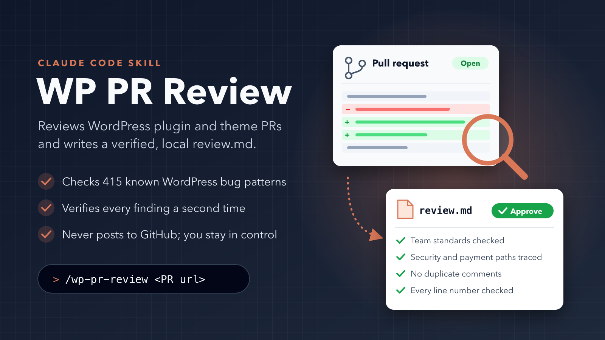

# wp-pr-review



A [Claude Code](https://claude.com/claude-code) skill that reviews GitHub pull requests for WordPress plugins and themes and writes the result to a local `review.md`.

Claude does the reviewing itself. Small Python helpers do the mechanical parts: fetching PR data, setting up the checkout, scanning the diff, checking for duplicate comments, and rendering the report. Nothing is posted to GitHub.

## What a review covers

- **PR context:** metadata, merge state, CI checks, every review thread with its replies, review bodies, conversation comments, and the author's test steps parsed from the PR body.
- **Team standards:** each team's coding standards are captured once (from URLs, GitHub files or local paths) and reused for all of that team's repos.
- **Known bug patterns:** a corpus of 415 historical WordPress bug patterns (`references/known-bug-patterns.md`), with a scanner that flags added lines matching their mechanical "detect by" shapes.
- **Security and correctness:** nonces and capabilities, request input, SQL binding, escaping, redirects, payment and state-transition paths, concurrency, performance and tests.
- **Verification:** every finding is re-checked in a second pass against 33 known false-positive traps (`references/verification-pitfalls.md`) before it reaches the report.
- **No duplicates:** findings are checked against everything already said on the PR, by any author, resolved or not.
- **Test steps:** the author's documented steps are classified and the safe ones are run. Anything that changes data needs your consent and a full database backup and restore.
- **Re-reviews:** a later round marks each earlier issue as persisting, fixed or new. Add `fresh` to review from scratch.

## Requirements

- Claude Code
- Python 3.8 or newer (the scripts use only the standard library)
- `git`
- [`gh`](https://cli.github.com/), authenticated with read access to the repos you review

## Install

Clone the repo and deploy the skill into your Claude Code skills folder:

```bash
git clone https://github.com/alhoseany/wp-pr-review.git
cd wp-pr-review
./deploy.sh        # copies the skill to ~/.claude/skills/wp-pr-review/
```

`deploy.sh` copies only the files the skill needs to run (no tests or caches). It respects `CLAUDE_CONFIG_DIR` if you set it. To work on the skill and use it at the same time, symlink the clone instead:

```bash
ln -s "$(pwd)" ~/.claude/skills/wp-pr-review
```

## Use

From the root of the project that holds the plugin or theme, ask Claude Code:

```text
/wp-pr-review https://github.com/<owner>/<repo>/pull/<number>
```

or just "review PR `<owner>/<repo>#<number>`". Add `fresh` to ignore earlier review rounds.

The first review for a new team asks which team the repo belongs to and for links to its coding standards. They are saved under `.pr-reviews/.standards/<team>/`.

Output goes to `.pr-reviews/<repo>/<pr>/review.md` at the root of the project you are reviewing (`<pr>-2`, `<pr>-3`, … for later rounds), never inside the skill folder. Add `.pr-reviews/` to your `.gitignore`.

## The report

The review is first written as `findings.json`, then rendered to `review.md` by `scripts/render_review.py`. The renderer derives everything that can be derived: header, CI line, counts table, the Approve / Request changes recommendation, editor and GitHub links, and code evidence. It refuses to write the report (exit 2, listing every problem) when a rule is broken, for example:

- a finding's `anchor` code is not on the line it cites, or a `path:N` in the text points past the end of the file
- a CRITICAL or MAJOR finding has no documented-intent line
- an author test step is not marked passed, failed or not run
- the stated recommendation contradicts the blocker rule
- the PR head moved during the review with no note about the new commits

The recommendation is binary. Any MAJOR or CRITICAL finding, a security or payment finding, merge conflicts, a branch behind its base, or a failing CI check blocks approval. A failing check that the team standards declare non-blocking (such as a coverage gate) can be waived with a reason.

## Helper scripts

| Script | What it does |
|---|---|
| `scripts/collect_pr.py` | PR metadata, merge state, CI, comments, review threads, test steps and your own earlier activity, as JSON. `--head` re-fetches only the head commit and merge state. |
| `scripts/setup_repo.py` | Checks out the PR branch safely (fork-aware, refuses to overwrite local work). |
| `scripts/scan_diff.py` | Lists leads from the bug-pattern corpus for the added lines. Skips vendored, built and test files by default. |
| `scripts/dedupe_check.py` | Flags findings that match an existing PR comment by location or wording. |
| `scripts/render_review.py` | Validates `findings.json` and renders `review.md`. `--verdict` prints only the recommendation; `--check` validates without writing. |
| `scripts/find_latest_review.py` | Finds the latest earlier review round for a PR. |
| `scripts/links.py` | Builds editor and GitHub links for a file and line. |
| `scripts/run-harvest.sh` | Fetches merged-PR records to grow the bug-pattern corpus (see below). |

## Growing the bug-pattern corpus

`scripts/run-harvest.sh` fetches merged-PR records for an organisation or a list of repos. It has no default target:

```bash
HARVEST_ORG=<org> scripts/run-harvest.sh
scripts/run-harvest.sh owner/repo [owner/repo ...]
```

It only writes raw records under `.harvest/`. Promoting them into the corpus is a separate, reviewed step described in `references/harvest-promotion.md`.

## Safety

- Nothing is posted to GitHub.
- PR bodies, comments and linked issues are treated as untrusted data. The skill never follows instructions found in them, and never runs an author's commands verbatim.
- The skill never changes the branch of a live checkout; it reviews in a detached worktree. It never runs `composer install` in a checkout that commits `vendor/`.
- Any test step that changes data runs only with your consent, after a verified full database backup, and is restored and verified afterwards.

## Development

```bash
python3 -m pip install pytest
python3 -m pytest -q
```

The tests cover every helper script and check that the report template, renderer and references agree with each other. Edit the skill in this repo and run `./deploy.sh` to update your installed copy.

## Author

Aladdin Alhoseany (<alhoseany@gmail.com>)

## License

[MIT](LICENSE)
